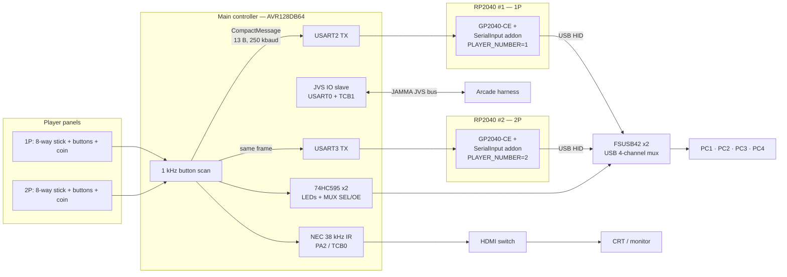

# MegaKey — JAMMA / Arcade Controller System

A complete custom **2-player arcade controller platform**: one microcontroller scans
both player panels and drives the entire cabinet — KVM host selection (USB multiplexer
+ IR HDMI switching), multi-protocol gamepad output through two GP2040-CE RP2040
boards, JAMMA JVS support, video conversion and sequenced power.

> **Developer: An Yeon-jo**

---

## System architecture

**Core loop (1 kHz):** scan panels → pack one 13-byte `CompactMessage` → broadcast on
two UARTs → each RP2040 keeps its own player's half and emits it as USB HID
(PS3/PS4/PS5/Xbox/XInput/Switch/Keyboard) → 74HC595 selects the USB mux channel and
KVM LEDs → NEC IR switches the matching HDMI input. In JVS mode the RP2040s go idle
and the AVR answers the arcade harness directly. Full wire format and 2P integration:
[`docs/rp2040-gp2040-addon.md`](docs/rp2040-gp2040-addon.md).

---

## Firmware modules & chipsets

| Module | Chipset | Toolchain | Role |
|---|---|---|---|
| [`firmware/MegaKey_AVR128DB64`](firmware/MegaKey_AVR128DB64/) | **Microchip AVR128DB64-I/PT** (AVR DB series, TQFP-64, 24 MHz internal OSCHF, 5 V) | Arduino IDE + **DxCore** | Main controller v4.0 — panel scan, protocol broadcast, KVM/IR/JVS |
| [`firmware/MegaKey_IO`](firmware/MegaKey_IO/) | **ATmega2560** (Arduino Mega 2560 PRO) | Arduino IDE (AVR core) | Previous generation v3.4 — same protocol on the Mega |
| [`firmware/MultiSourceController`](firmware/MultiSourceController/) | **ATmega32U4** (Arduino Pro Micro, 5 V/16 MHz) | Arduino IDE (AVR core) | Composite / S-Video / VGA-15kHz → JAMMA RGB via CXA2025AS + 74HC4052 + LM1881, SSD1306 OLED UI |
| [`firmware/PowerController`](firmware/PowerController/) | **ATmega32U4** (Arduino Pro Micro) | Arduino IDE (AVR core) | 5 relay groups (JAMMA/TTX3/Naomi/AC×2) + PWM cabinet lighting (IRLZ44N) |
| [`firmware/IR_SignalAnalyzer`](firmware/IR_SignalAnalyzer/) | any 5 V AVR Arduino (ATmega328P/2560 class) | Arduino IDE (AVR core) | Debug utility — captures raw IR pulse trains to identify NEC codes |
| [`rp2040/addons`](rp2040/addons/) | **Raspberry Pi RP2040** (Waveshare RP2040-Zero) | GP2040-CE source build (Pico SDK) | **Serial Input Addon v2.4** — receives the UART frames and injects them into GP2040-CE as a gamepad |
| [`rp2040/firmware/BoardConfig.h`](rp2040/firmware/BoardConfig.h) | RP2040 (Waveshare Zero) | GP2040-CE | Custom board definition — all GPIOs unassigned so the addon drives input in software |

### `firmware/MegaKey_AVR128DB64` — main board (AVR128DB64)

- Scans 1P/2P button matrices at 1 kHz into 32-bit bitmaps.
- Mode select from the 1P panel: `X`=Dreamcast · `Y`=PS3 · `A`=PS4 · `B`=Switch ·
  `LB`=Keyboard · `RB`=PS5 · `LT`=Xbox.
- Broadcasts `CompactMessage` on USART2 (`PF0`) and USART3 (`PB0`) at 250 000 baud.
- 2× 74HC595 (data `PF4`, clock `PF5`, latch `PF6`) drive KVM LEDs, status LED and
  the USB mux SEL/OE lines. **PF6 requires the reset fuse disabled** (DxCore
  "Reset: GPIO").
- NEC IR on `PA2` (TCB0 PWM, 38 kHz) switches the HDMI input; 2N2222-driven 940 nm LED.
- JVS IO slave on USART0 with TCB1-generated sense signal.
- Docs: [`firmware-MegaKey_AVR128DB64.md`](docs/firmware-MegaKey_AVR128DB64.md)

### `firmware/MegaKey_IO` (ATmega2560)

The v3.4 predecessor of the above: same loop and packet format, but IR on `D3`
(forced Timer3), USB mux on GPIO `A10/A12/A14/A15`, JVS sense on Timer2. Kept as the
reference implementation of the protocol.
Docs: [`firmware-MegaKey_IO.md`](docs/firmware-MegaKey_IO.md)

### `firmware/MultiSourceController` (ATmega32U4)

I²C (0x44) control of a CXA2025AS video encoder, 74HC4052 input mux, LM1881 sync
separation. Contrast/hue/saturation/brightness adjustment with EEPROM persistence and
a 4-button + SSD1306 OLED front panel. C-TRAP is enabled only for composite.
Docs: [`firmware-MultiSourceController.md`](docs/firmware-MultiSourceController.md)

### `firmware/PowerController` (ATmega32U4)

Latching switch inputs select relay groups (shared with button LEDs); lighting level
from a potentiometer via PWM; boot animation never toggles relay pins.
Docs: [`firmware-PowerController.md`](docs/firmware-PowerController.md)

### `firmware/IR_SignalAnalyzer` (AVR)

Bare-metal pulse-capture sketch (interrupt on pin 2) that prints raw IR timings over
serial — used to verify the HDMI switch's NEC codes. Fixes the first-pulse overflow
bug of earlier versions.
Docs: [`firmware-IR_SignalAnalyzer.md`](docs/firmware-IR_SignalAnalyzer.md)

### `rp2040` — GP2040-CE Serial Input Addon (RP2040)

A GP2040-CE addon compiled **per player** (`PLAYER_NUMBER=1|2`): receives the shared
13-byte frame on UART1 RX (`GP5`, via a TXS0108E level shifter), CRC8-validates it,
merges its own player's bitmaps into the GP2040 `GamepadState`, and switches the USB
protocol (watchdog reboot) when the Arduino changes mode. Also owns a per-player
SSD1306 OLED and WS2812, and can replay the pad on a real Dreamcast Maple bus via PIO.

⚠️ Requires the GP2040-CE **Display addon and PlayerLED addon disabled** (resource
exclusivity). Docs: [`rp2040-gp2040-addon.md`](docs/rp2040-gp2040-addon.md)

---

## KVM channel truth table

| Channel | MUX1_SEL | MUX1_OE | MUX2_SEL | MUX2_OE | Result |
|---|---|---|---|---|---|
| CH1 | 0 | 0 (ON) | X | 1 (OFF) | USB → PC1 |
| CH2 | 1 | 0 (ON) | X | 1 (OFF) | USB → PC2 |
| CH3 | X | 1 (OFF) | 0 | 0 (ON) | USB → PC3 |
| CH4 | X | 1 (OFF) | 1 | 0 (ON) | USB → PC4 |
| CH5 (JAMMA) | X | 1 (OFF) | X | 1 (OFF) | USB blocked — JVS + HDMI only |

(OE active low. Details: [`docs/circuit-ir-usb-mux.md`](docs/circuit-ir-usb-mux.md),
[`docs/fsusb42-usb-mux.md`](docs/fsusb42-usb-mux.md).)

## Documentation

| Document | Contents |
|---|---|
| [`docs/ARCHITECTURE.md`](docs/ARCHITECTURE.md) | Whole-system composition, module map, wiring index |
| [`docs/rp2040-gp2040-addon.md`](docs/rp2040-gp2040-addon.md) | Wire format, 2-player integration, GP2040-CE build guide |
| [`docs/circuit-ir-usb-mux.md`](docs/circuit-ir-usb-mux.md) | IR driver circuit, mux control, BOM, PCB layout rules |
| [`docs/fsusb42-usb-mux.md`](docs/fsusb42-usb-mux.md) | USB mux (FSUSB42) chip control semantics |
| [`docs/firmware-*.md`](docs/) | Per-module documentation |

## Hardware (EasyEDA)

The matching PCB/schematic designs are archived under
[`hardware/`](hardware/) — one folder per board, mapped to the firmware modules
(the online source project requires the designer's EasyEDA login).

## License

Each module follows its own SPDX header; where no notice is present the source is MIT.
JVSIO library under `firmware/*/jvsio/` retains its upstream license.
