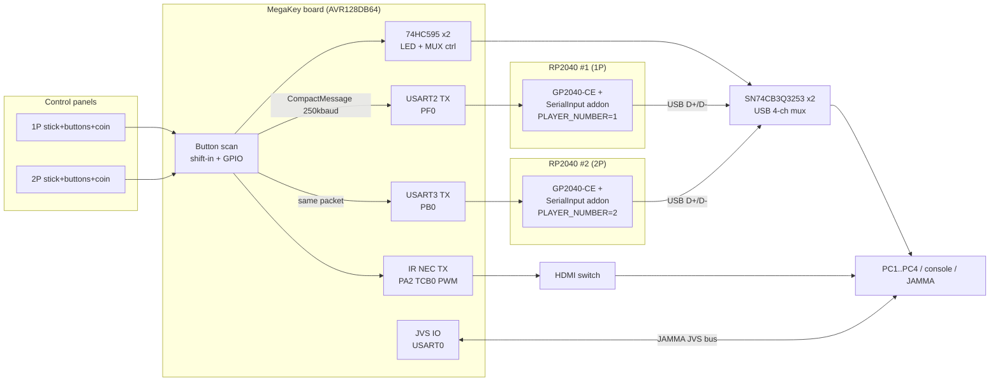

# MegaKey System Architecture

Overall system composition and how the modules connect.

## What this system is

MegaKey is a custom **2-player arcade controller hub**. Two JAMMA-style control panels
(8-way stick + buttons + coin/Start) are scanned by one microcontroller, which then
drives the rest of the cabinet automatically:

1. **Which machine/PC the players see** — KVM channel select (USB multiplexer + HDMI
   switch via IR).
2. **What protocol the pads speak** — two GP2040-CE RP2040 boards re-broadcast the pad
   state as PS4 / PS5 / Xbox / Switch / XInput / Keyboard / JVS / Dreamcast HID.
3. **What video path feeds the CRT** — multi-source converter and sequenced power.



## Data flow (the core loop, 1 kHz)

```
scanPlayerButtons(1P/2P)          -> p1_buttons, p2_buttons (32-bit bitmaps)
mode select (1P held button)      -> selected_mode (0..8)
pack CompactMessage (13 bytes)    -> CRC8 -> Serial2 + Serial3 (identical packet)
RP2040 addon: pick own half       -> merge into GP2040 GamepadState -> USB HID
74HC595: KVM LEDs, MUX SEL/OE     -> USB routed to active PC
IR (NEC): HDMI switch channel     -> video follows the same channel
```

Both RP2040s receive the **same** packet; each keeps only the field matching its
compile-time `PLAYER_NUMBER` (see `rp2040-gp2040-addon.md`).

## Module map

| Module | MCU | Role |
|---|---|---|
| [`firmware/MegaKey_AVR128DB64`](../firmware/MegaKey_AVR128DB64/) | AVR128DB64 | **Main controller (v4.0)** — scans pads, packs protocol, drives KVM/IR/JVS |
| [`firmware/MegaKey_IO`](../firmware/MegaKey_IO/) | Arduino Mega 2560 | Previous generation (v3.4), same protocol |
| [`firmware/MultiSourceController`](../firmware/MultiSourceController/) | ATmega32U4 | Composite/S-Video/VGA15kHz → JAMMA RGB (CXA2025AS) |
| [`firmware/PowerController`](../firmware/PowerController/) | ATmega32U4 | Relay power sequencing + cabinet lighting |
| [`firmware/IR_SignalAnalyzer`](../firmware/IR_SignalAnalyzer/) | any 5V AVR | Debug utility — captures raw IR pulse trains |
| [`rp2040/addons`](../rp2040/addons/) | RP2040 | GP2040-CE **Serial Input Addon** v2.4 (this repo's RP2040 side) |
| [`rp2040/firmware/BoardConfig.h`](../rp2040/firmware/BoardConfig.h) | RP2040 | Waveshare RP2040-Zero custom board definition |

## Control channels

### KVM channel truth table (USB multiplexer)

Driven from the 74HC595 bits `MUX1_SEL/1_OE/2_SEL/2_OE`:

| Channel | MUX1_SEL | MUX1_OE | MUX2_SEL | MUX2_OE | USB path |
|---|---|---|---|---|---|
| CH1 | 0 | 0 (ON) | X | 1 (OFF) | PC1 |
| CH2 | 1 | 0 (ON) | X | 1 (OFF) | PC2 |
| CH3 | X | 1 (OFF) | 0 | 0 (ON) | PC3 |
| CH4 | X | 1 (OFF) | 1 | 0 (ON) | PC4 |
| CH5 (JAMMA) | X | 1 (OFF) | X | 1 (OFF) | none — HDMI only, pads go through JVS |

Details: [`complete_circuit_diagram.html`](complete_circuit_diagram.html),
[`sn74cb3q3253_pinmap.html`](sn74cb3q3253_pinmap.html).

### Pad protocol modes (`selected_mode`)

| Value | Mode | Delivered by |
|---|---|---|
| 0 | Keyboard | GP2040-CE keyboard mode |
| 1 | XInput | GP2040-CE |
| 2 | Switch | GP2040-CE |
| 3 | PS3 | GP2040-CE |
| 4 | PS4 | GP2040-CE (default) |
| 5 | PS5 | GP2040-CE |
| 6 | Xbox | GP2040-CE |
| 7 | JVS | JVS IO on the AVR itself (RP2040 outputs stay idle) |
| 8 | Dreamcast | RP2040 PIO Maple-bus output + merged pad state |

Mode is selected from the **1P panel** (hold while entering select state):
`X`=Dreamcast, `Y`=PS3, `A`=PS4, `B`=Switch, `LB`=Keyboard, `RB`=PS5, `LT`=Xbox.

## Power / video chain

```
Mains ─ PowerController ─┬─ JAMMA harness (CH5)
   (relay K1..K7)        ├─ TTX3 / Naomi boards
                         └─ AC outlets (console, monitors)
Video sources ─ MultiSourceController (CXA2025AS) ─ JAMMA RGB
PC / console HDMI ─ IR switch ─ CRT/HDMI monitor
```

## Wiring index

| From | To | Signal |
|---|---|---|
| AVR `PF0` (USART2 TX) | RP2040 #1 `GP5` (UART1 RX) | CompactMessage, 250000 baud, via TXS0108E level shifter |
| AVR `PB0` (USART3 TX) | RP2040 #2 `GP5` (UART1 RX) | same packet |
| AVR `PF4/PF5/PF6` | 74HC595 SER/SRCLK/RCLK | 16-bit LED + MUX control |
| AVR `PA2` (TCB0 PWM) | IR LED (940 nm, 2N2222 driver) | NEC 38 kHz HDMI-switch commands |
| AVR `USART0` + TCB1 | JVS RX/TX/SENSE | JAMMA JVS bus |
| RP2040 `GP0/GP1` | SSD1306 OLED (i2c0, 0x3C) | per-player status display |
| RP2040 `GP16` | WS2812 | mode/connection status LED |
| RP2040 #1 `GP28` | TXS0108E OE | level-shifter enable (1P board) |
