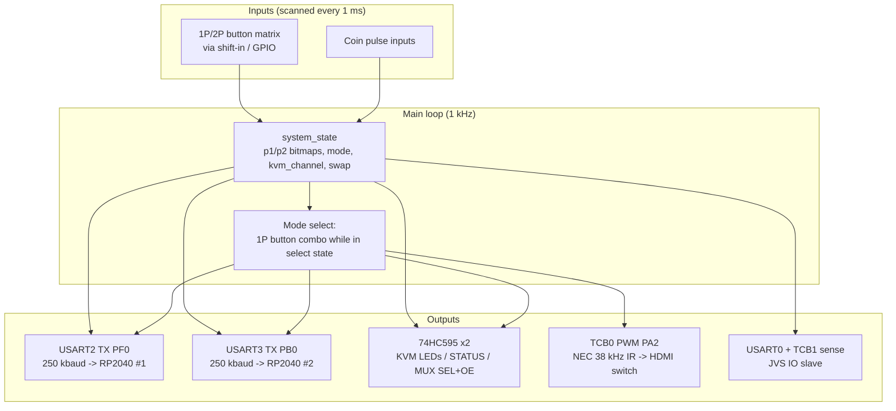

# MegaKey_AVR128DB64 — Main Board Firmware (v4.0)

Target: **AVR128DB64-I/PT** (TQFP-64, 24 MHz internal OSCHF, 5 V) ·
Toolchain: Arduino IDE + [DxCore](https://github.com/SpenceKonde/DxCore) ·
Board setting: *AVR DB series → AVR128DB64*, Reset = GPIO (PF6, no Reset), 24 MHz internal.

This is the heart of the cabinet: it scans both player panels at 1 kHz, broadcasts a
13-byte `CompactMessage` to the two GP2040-CE boards, selects the KVM USB channel
through two 74HC595 shift registers, switches the HDMI source with NEC IR, and can act
as a JVS IO device on a JAMMA harness.

## Files

| File | Purpose |
|---|---|
| `MegaKey_AVR128DB64.ino` | Main sketch: scan loop, mode select, packet TX, IR, coin, KVM |
| `pins_megakey.h` | Pin map for the PCB (`PIN_Pxn` names, 74HC595 SPI pins, bit assignments) |
| `shift_register.h` | `ShiftRegister16` — 2× cascaded 74HC595 driver, software-SPI, dirty-flag flush |
| `jvs_avrdb.h` | JVS physical layer ported to AVR-DB: USART0 + TCB1 PWM sense signal |
| `jvsio/` | Bundled [JVSIO library](https://github.com/twitter/jvsio) sources |

## Block diagram



## Main loop

```
loop @1ms:
  scanPlayerButtons(p1_buttons[]), scanPlayerButtons(p2_buttons[])
  handleModeSelect()          // 1P combo -> selected_mode 0..8
  sendToRP2040()              // CompactMessage -> Serial2 + Serial3 (see below)
  updateShiftRegister()       // KVM LEDs + MUX SEL/OE for kvm_channel
  handleCoin()                // coin pulse -> JVS credit or PC keypress
  (on channel change) sendIR()  // NEC code for HDMI switch channel
```

Button bitmaps use the shared bit layout (`BIT_UP..BIT_RT`, documented in
[`rp2040-gp2040-addon.md`](rp2040-gp2040-addon.md)).

## Packet to the RP2040s

`sendToRP2040()` builds a packed 13-byte frame — header `0xAA`, 32-bit 1P bitmap,
32-bit 2P bitmap, `modes` byte (mode in high nibble, analog flags low nibble),
`channel_state` (KVM channel high nibble, stick-swap bit0), CRC8, footer `0x55` — and
writes the **identical frame** to `Serial2` and `Serial3`. Full wire format:
[`rp2040-gp2040-addon.md`](rp2040-gp2040-addon.md).

## 74HC595 output map (`pins_megakey.h`)

| Bit | Signal | Meaning |
|---|---|---|
| 0–4 | KVM1..KVM5_LED | channel indicator LEDs |
| 5 | STATUS_LED | board heartbeat |
| 6 | MUX1_SEL | USB mux #1 channel select |
| 7 | MUX1_OE | USB mux #1 output enable (**active low**) |
| 8 | MUX2_SEL | USB mux #2 channel select |
| 9 | MUX2_OE | USB mux #2 output enable (**active low**) |

Driver pins: `SER=PF4`, `SRCLK=PF5`, `RCLK=PF6`. PF6 doubles as reset — the
**RESET fuse must be disabled** in DxCore ("Reset: GPIO"), otherwise latch pulses
reset the MCU.

## JVS porting notes (v4.0 vs. Mega v3.4)

| Original (Mega 2560) | AVR128DB64 |
|---|---|
| Timer2 for JVS sense | **TCB1** PWM (`jvs_avrdb.h`) |
| `UCSR2B/UCSR3B` registers | `USART2.CTRLB / USART3.CTRLB` |
| Timer3 forced for IRremote | DxCore assigns TCB automatically (no `IR_USE_AVR_TIMER3`) |
| direct `DDRB/PORTB` writes | 74HC595 bits (LED/MUX moved off GPIO) |

## Libraries

- **JVSIO** — vendored under `jvsio/`; included as `"jvsio/JVSIO.h"` + `.cpp` (Arduino
  sketch-folder style). Client header: `jvsio/clients/MegaClient.h`.
- **IRremote v4.x** — `#include <IRremote.hpp>`; NEC encoding on the TCB0-driven pin.

## Build & flash

1. Install DxCore; select *AVR128DB64*, Reset=GPIO, 24 MHz internal.
2. Programmer: UPDI (e.g. `jtag2updi` or any Arduino as ISP on UPDI pin).
3. Open `MegaKey_AVR128DB64.ino`, compile, upload.
