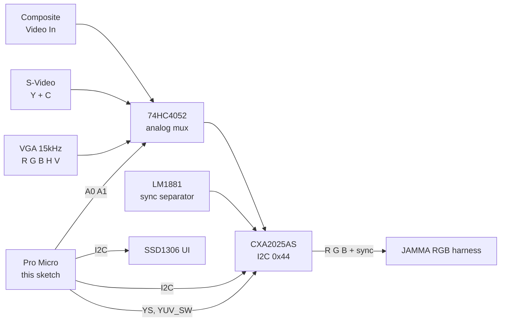

# MultiSourceController — Composite / S-Video / VGA15kHz → JAMMA RGB

Target: **Arduino Pro Micro** (ATmega32U4 5 V/16 MHz) ·
Video encoder: **CXA2025AS** (I²C, addr `0x44`) · channel mux: **74HC4052** ·
sync: **LM1881** · UI: SSD1306 OLED 128×64.

Feeds arcade CRT/JAMMA inputs from modern-ish sources.

## Signal path

## Controls & UI

4 buttons: `INPUT` (cycle source), `MODE` (adjustment field), `+` / `−` (values).
Adjustable registers: contrast `0x00`, hue `0x01`, saturation `0x02`, brightness
`0x03` — persisted in EEPROM. The header shows the active input icon; a progress bar
shows the selected value.

### C-TRAP logic (register `0x00`, bit 6)

| Input | C-TRAP | Reason |
|---|---|---|
| Composite | **ON** | chroma must be notched out of Y |
| S-Video | OFF | Y is already separated |
| VGA | OFF | direct RGB path |

The sketch preserves the C-TRAP bit whenever contrast is written
(`writeContrastReg()`).

## Pin map

| Function | Arduino pin |
|---|---|
| I²C SDA / SCL (CXA2025AS + OLED) | 2 / 3 |
| `YS` (Y/C vs RGB block select) | 4 |
| `YUV_SW` (internal Y/C path) | 5 |
| Buttons INPUT / MODE / + / − | 6 / 7 / 8 / 9 |
| 74HC4052 `A0` / `A1` | 10 / 14 |

## Build

Arduino IDE, board *Pro Micro (5V/16MHz)*, libraries `Wire`, `EEPROM`,
`Adafruit_GFX`, `Adafruit_SSD1306`. If the OLED is absent the sketch continues to
drive the video path (`oled_ok=false`) — the display is optional at run time.
