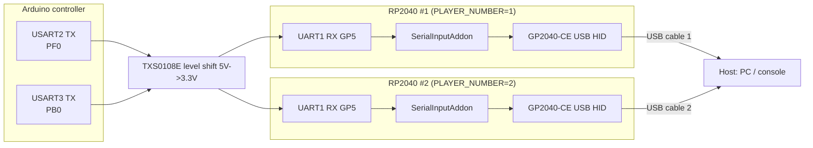
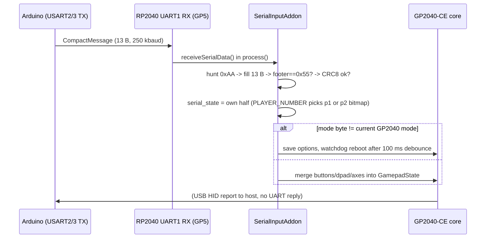

# RP2040 / GP2040-CE Serial Input Addon — 2-Player Joystick Integration

How the Arduino (AVR128DB64 / Mega 2560) drives **two GP2040-CE RP2040 boards** over
one-way UART so that a single arcade panel set behaves as a **2-player USB joystick**
on any host (PC / PS4 / PS5 / Switch / Xbox / Dreamcast / JVS).



The two RP2040s are **independent USB devices**. The Arduino sends the *same* 13-byte
frame on both UARTs; each addon keeps only the half that belongs to its player.

---

## 1. Wire format — `CompactMessage` (13 bytes, packed)

Defined identically in `firmware/MegaKey_AVR128DB64/MegaKey_AVR128DB64.ino` (TX side)
and `rp2040/addons/serial_input.h` (RX side).

| Offset | Size | Field | Notes |
|---|---|---|---|
| 0 | 1 | `header` | always `0xAA` — RX resync anchor |
| 1 | 4 | `p1_buttons` | little-endian 32-bit button bitmap (1P) |
| 5 | 4 | `p2_buttons` | little-endian 32-bit button bitmap (2P) |
| 9 | 1 | `modes` | high nibble = protocol mode (0–8); low nibble = analog flags (bit0 1P-L, bit1 1P-R, bit2 2P-L, bit3 2P-R) |
| 10 | 1 | `channel_state` | high nibble = KVM channel (1–5); bit0 = stick-swap |
| 11 | 1 | `crc` | CRC8 over bytes 0…10 |
| 12 | 1 | `footer` | always `0x55` |

- **UART:** 250 000 baud, 8N1. Arduino transmits **one-way**; RP2040 never replies.
- **Rate:** every main-loop tick (≈1 kHz, 13 bytes ≈ 0.52 ms of airtime — fits).
- **CRC8:** polynomial reflected `0x8C`, init `0x00`, no final XOR (same routine both sides).

### Button bitmap bits (shared by both sides)

| Bit | Button | Bit | Button | Bit | Button |
|---|---|---|---|---|---|
| 0 | SELECT/BACK | 7 | A | 14 | RT |
| 1 | HOME | 8 | B | 18 | TOUCH |
| 2 | START | 9 | X | | |
| 3 | UP | 10 | Y | | |
| 4 | DOWN | 11 | LB | | |
| 5 | RIGHT | 12 | RB | | |
| 6 | LEFT | 13 | LT | | |

### Mode values

| `mode` | Protocol | RP2040 behaviour |
|---|---|---|
| 0 | Keyboard | GP2040-CE keyboard mode |
| 1 | XInput | GP2040-CE |
| 2 | Switch | GP2040-CE |
| 3 | PS3 | GP2040-CE |
| 4 | PS4 | GP2040-CE |
| 5 | PS5 | GP2040-CE |
| 6 | Xbox | GP2040-CE |
| 7 | JVS | addon returns early — AVR's own JVS IO answers on the JAMMA bus |
| 8 | Dreamcast | pad state merged **and** replayed on the Maple bus via PIO |

---

## 2. Addon receive pipeline



State handling in `receiveSerialData()`:

1. Byte `0xAA` → reset buffer index, start frame.
2. Collect until `sizeof(CompactMessage)`; validate footer, then CRC8.
3. On success: store `p1_buttons`, `p2_buttons`, `input_mode = (modes>>4)&0x0F`,
   `channel`, `channel_state`; refresh `last_receive_time`.
4. Failure counters (kept in `error_stats`, shown on OLED): `crc_errors`,
   `invalid_headers`, `invalid_footers`, `buffer_overflows` (RX capped at
   `MAX_BYTES_PER_FRAME=64` bytes per tick).

**Player selection** (the 2P trick):

```cpp
uint32_t current_buttons = (PLAYER_NUMBER == 1)
                           ? serial_state.p1_buttons
                           : serial_state.p2_buttons;
```

`PLAYER_NUMBER` is a **compile-time** define — build the firmware twice, once per
board. Both binaries see the same wire data but expose different halves.

**Stick swap**: the Arduino already swaps the two bitmaps inside `sendToRP2040()`
when `channel_state` bit0 is set, so the addon needs no swap logic.

**Connection watchdog**: no valid frame for `CONNECTION_TIMEOUT_US = 500 ms` →
`handleConnectionRecovery()` clears the pad state (no stuck buttons) and flags the
error on the LED/OLED.

**Mode switching**: `convertToGP2040Mode()` maps the Arduino mode byte to GP2040-CE
`InputMode`. A differing mode must survive `MODE_CHANGE_DELAY_US = 100 ms` of
consistent packets before the addon writes storage and **reboots via watchdog** —
GP2040-CE can only change USB protocol at boot. 2P boards delay 50 ms extra to avoid
both rebooting into enumeration simultaneously.

---

## 3. RP2040 hardware resources used by the addon

Defined in `rp2040/addons/serial_input.h`:

| Resource | Pin(s) | Notes |
|---|---|---|
| UART1 RX | **GP5** | from level shifter; baud 250 000 |
| I2C0 (OLED SSD1306 0x3C) | GP5→SDA GP0, SCL GP1 | 128×64 status display, drawn by the addon itself (5×7 font) |
| WS2812 | **GP16** | mode/connection status (RGB, PIO-driven) |
| TXS0108E OE | **GP28** (1P build) | addon enables the level shifter at boot |
| Dreamcast Maple | A=GP10, B=GP11, SENSE=GP12, PIO_EN=GP21 | PIO `maple_bus.pio` replies to a real Dreamcast console |

> ⚠️ **Mandatory GP2040-CE config** (conflict law):
> - **Display addon: DISABLE** — the SerialInput addon owns I2C0/OLED exclusively.
> - **PlayerLED addon: DISABLE** — the addon owns the WS2812 PIO exclusively.
> Configure via the GP2040-CE web configurator or `AddonsConfig.pb` defaults.

---

## 4. Building & flashing (per player)

The addon lives **inside a GP2040-CE source tree**; this repo keeps the two files as
the source of truth.

```
gp2040-ce/
├── src/addons/serial_input.{h,cpp}   ← copy from rp2040/addons/
├── src/addons/maple_bus.pio          ← PIO program used by Dreamcast mode
└── include/addons/serial_input.h     ← header install path used by #include
```

1. Clone GP2040-CE and follow its *Building* doc (Pico SDK + arm-none-eabi-gcc).
2. Copy `serial_input.h/cpp` into `src/addons/`, and register the addon in GP2040-CE's
   addon list (`AddonManager` construction in `src/main.cpp`, next to the built-in
   addons):
   ```cpp
   addons.push_back(new SerialInputAddon());
   ```
3. Set the player number for **each board's build**:
   ```bash
   # 1P board
   cmake -DPLAYER_NUMBER=1 ...        # or add target_compile_definitions(... PRIVATE PLAYER_NUMBER=1)
   # 2P board
   cmake -DPLAYER_NUMBER=2 ...
   ```
   (`serial_input.h` defaults to `PLAYER_NUMBER 1` when undefined.)
4. Build the `waveshare_rs` / RP2040-Zero target using `rp2040/firmware/BoardConfig.h`
   (copy over the stock Waveshare Zero board config; GPIOs are all `NONE` because the
   addon injects input in software — physical pins stay free for UART/OLED/WS2812).
5. Flash via BOOTSEL UF2 (or `picotool load`). Repeat with the other `PLAYER_NUMBER`.

### Wiring checklist

- Arduino TX (5 V logic) → **TXS0108E** → RP2040 GP5 (3.3 V). Do not feed 5 V to the RP2040.
- Common ground between Arduino, level shifter, both RP2040 USB supplies.
- One RP2040 on USART2 (`PF0`), the other on USART3 (`PB0`) — 1P on Serial2, 2P on Serial3.
- USB from each RP2040 to the host (through the KVM USB mux if using channels).

---

## 5. End-to-end example — "2P stick on PS4"

1. Player presses **A on the 1P panel in mode-select state** → Arduino sets
   `selected_mode = MODE_PS4 (4)`.
2. Every 1 ms the Arduino sends `CompactMessage{0xAA, p1, p2, 0x40|analog, chan, crc, 0x55}`
   on Serial2 and Serial3.
3. Both addons see mode 4; after 100 ms stability each saves `INPUT_MODE_PS4` and
   watchdog-reboots into PS4 (DualShock 4 HID) mode.
4. On the bus: RP2040 #1 enumerates as pad 1 exposing only `p1_buttons`; RP2040 #2 as
   pad 2 exposing only `p2_buttons` → the PS4 sees a normal wired **2-player pad set**.
5. `LB` (1P) switches to keyboard mode, `RB`/`LT` to PS5/Xbox, etc. — same mechanism.
6. In `MODE_JVS (7)` the addons go silent and the AVR answers the arcade harness
   directly through JVS IO.

---

## 6. Debug & observability

- **OLED** shows per-player: mode string, own pad mode, connection/timeout, error
  counters — four layouts (`updateDisplay*()` variants).
- **WS2812**: colour = current mode; blink pattern = connection state; boot animation
  while waiting for the first frame.
- `#define DEBUG_MODE` in `serial_input.h` enables UART printf diagnostics
  (`printErrorStats()`, `printKeyboardMapping()`).
